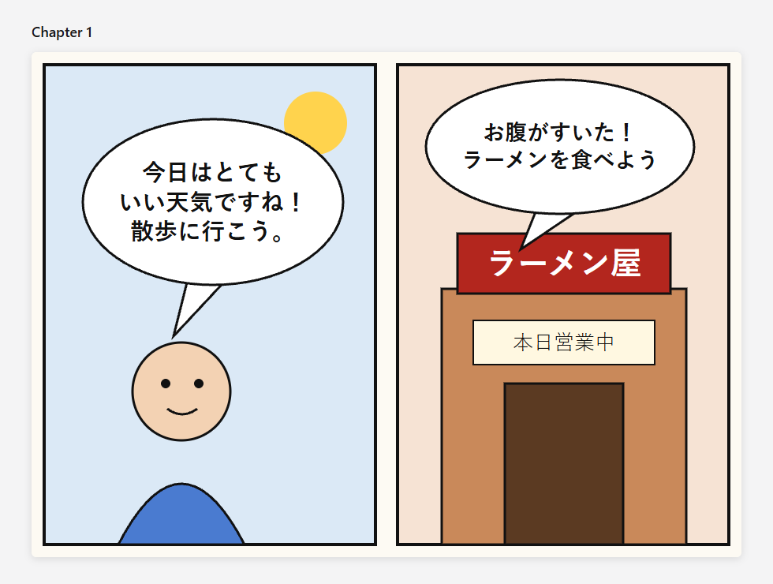
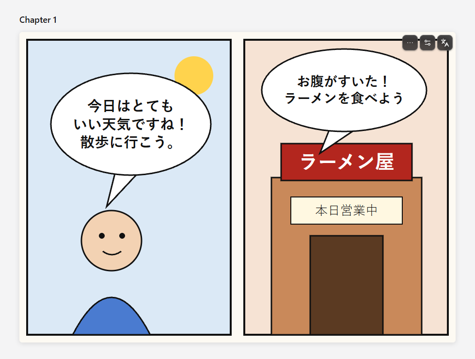
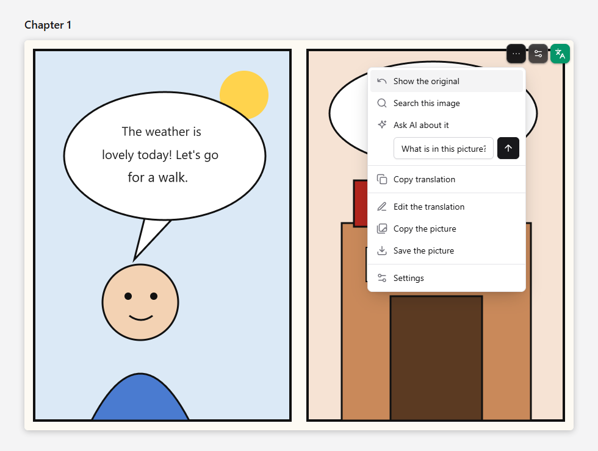
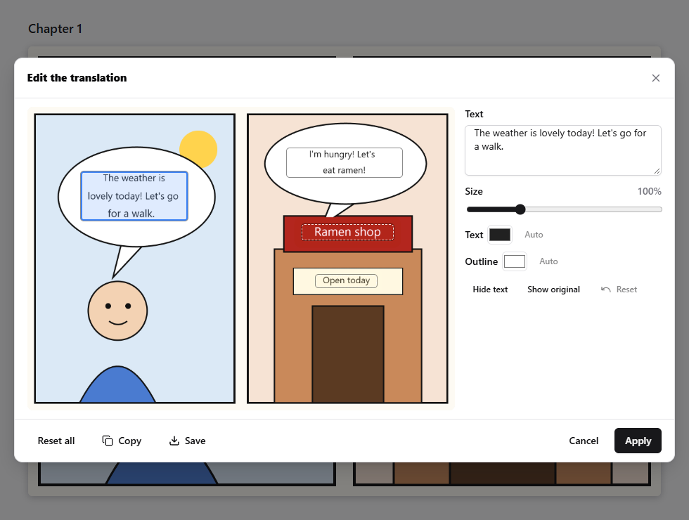
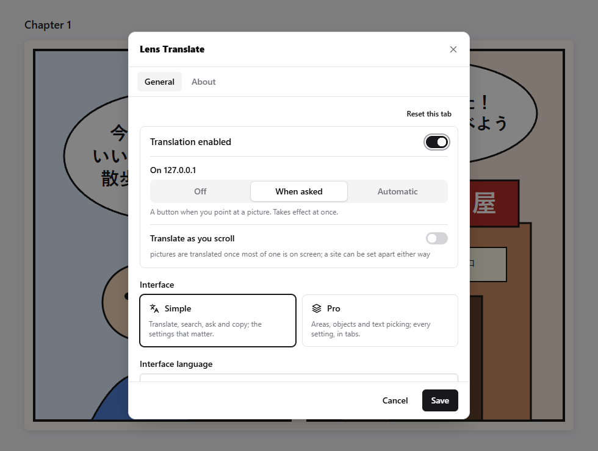
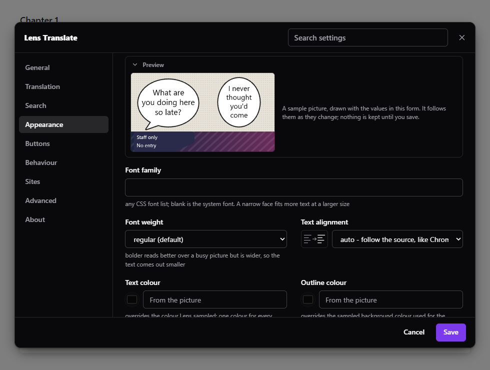
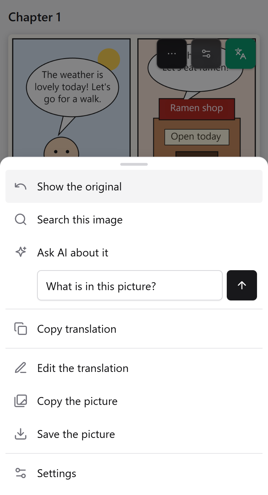

# Lens Translate

A userscript that translates the text **inside pictures**, right where it is: manga, memes, signs, screenshots. It uses Google Lens, the same way Chrome's own Lens overlay does, and needs no server, no extension and no account.

| Before | After |
|---|---|
|  |  |

## Install

1. Install a userscript manager: [Tampermonkey](https://www.tampermonkey.net/) or [Violentmonkey](https://violentmonkey.github.io/). [AdGuard](https://adguard.com/) works too: **Settings → Extensions → Add extension**.
2. [**Install Lens Translate**](https://github.com/bropines/chrome-lens-userscript/raw/main/dist/lens-translate.user.js).

It updates itself. Works on desktop and on Android.

## Use

- **Point at a picture and press the button** that appears in its corner. Press it again to undo.
- **Hold the button** to peek at the original.
- **Alt+click** a picture translates it too; **Alt+Shift+T** translates everything on screen.
- On a **phone** the button sits over the picture you are reading. Tap it.
- The **`...` button** has the rest: search the image, ask AI about it, copy the text, copy or save the translated picture, fix the translation by hand.

| The menu | Fixing a translation by hand |
|---|---|
|  |  |

## Settings

The gear next to the button opens them. **Simple** mode is one page with what matters: the translation language, switching it off for a site, translating as you scroll, theme and accent colour. **Pro** mode has every setting, in tabs, with a live preview of how a translation will be drawn.

| Simple | Pro, dark theme |
|---|---|
|  |  |

On a phone, everything opens as a sheet from the bottom:

The interface is in English, Russian, Ukrainian, German, Spanish, French, Portuguese, Turkish, Japanese, Korean and Chinese.

## Privacy

- Translating or searching sends **the picture** to Google Lens. Nothing else from the page.
- If **Remember across reloads** is on (the default), answers are kept in the browser, in the storage of the site where you translated them. **Clear cache** in the menu empties it.
- The interface translation for your language is downloaded once per version from this repository on GitHub. In English, nothing is downloaded.

## Something does not work?

Add **`#lens-debug`** to the end of the page address and press Enter. A report opens and says what is wrong: the transport, a blocked domain, or no connection. More in [troubleshooting](docs/troubleshooting.md).

## More

- [Using it](docs/usage.md): every feature and setting, shortcuts, searching with a picture
- [Troubleshooting](docs/troubleshooting.md): diagnostics, DevTools on a phone, how hosts differ
- [Interface language](docs/interface-language.md): adding or fixing a translation of the interface
- [How it works](docs/how-it-works.md): the Lens protocol, rendering, manga mode, caching
- [What Lens can do](docs/lens-capabilities.md), and what this script does with it
- [Development](docs/development.md): building, the source layout, using the engine from another script

[chrome-lens-py](https://github.com/bropines/chrome-lens-py) is the Python version of the same thing, with a CLI.

## License

MIT
